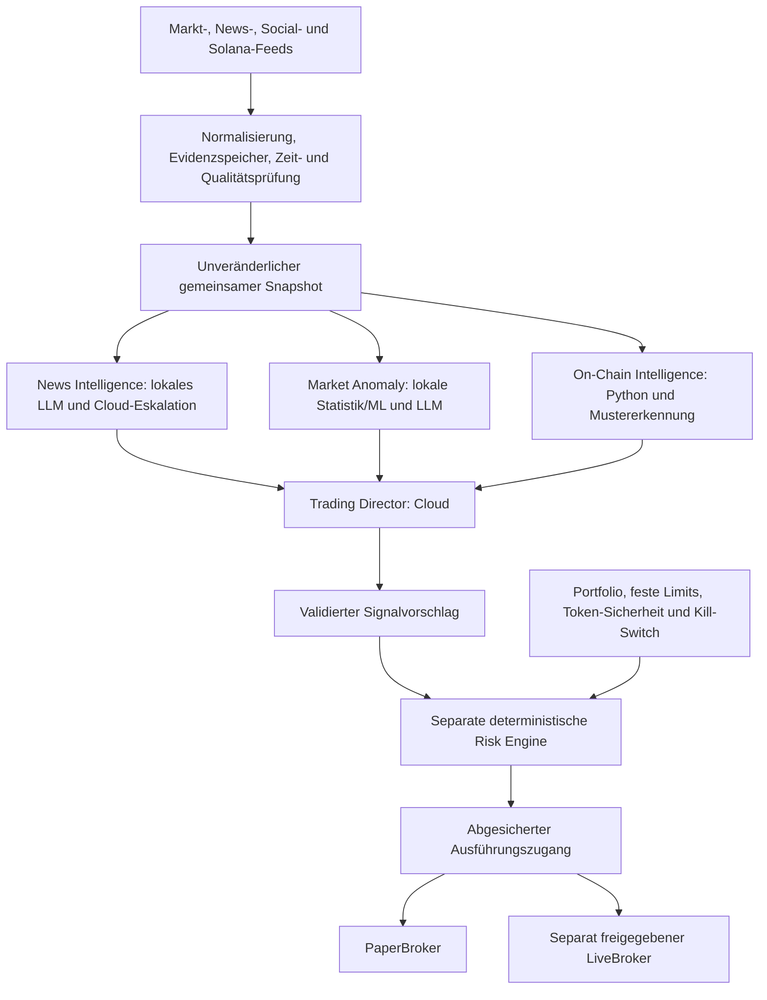

# Zielarchitektur: ereignisgestützte Solana-Trading-Engine

Festgehalten auf Nutzerwunsch am 21. Oktober 2026. Dies ist die verbindliche
Entwicklungsrichtung für spätere Schritte. Die vier unten beschriebenen Rollen,
lokale Modellrouten, Social-/On-Chain-Überwachung und Anomaly-Modelle sind
**noch nicht implementiert**. Der aktuelle Research-Lauf bleibt bis zur getesteten
Migration Director-These -> Quant -> Sentiment -> Risk -> Director-Synthese.

Ziel sind begründete Handelsgelegenheiten über **Minuten bis Stunden**.
Sekunden-Sniping und ein Geschwindigkeitswettbewerb mit spezialisierten
Low-Latency-Bots gehören nicht zum Ziel. RSI/MACD sind reproduzierbare Merkmale
und Vergleichsbaselines; sie ersetzen keine ereignisgestützte Strategie.

## Rollen und Rechenorte

| Rolle | Aufgabe und Eingaben | Geplanter Rechenort | Strukturierte Ausgabe |
| --- | --- | --- | --- |
| **News Intelligence Agent** | Nachrichten, Ankündigungen und Social-Media-Beiträge überwachen; Ereignisse erkennen, betroffene Coins anhand Chain/Mint zuordnen, mögliche Auswirkungen und Neuigkeitswert gegenüber bereits bekanntem Wissen bestimmen | Lokales LLM; begrenzte Cloud-Eskalation bei unklaren, widersprüchlichen oder besonders relevanten Meldungen | Ereignistyp, betroffene Mints, Originalquellen, Erstkenntnis/Publikationszeit, neu/bereits bekannt/unklar, Wirkungshypothese, Gegenbelege, Unsicherheit |
| **Market Anomaly Agent** | Ungewöhnliche Preis-/Volumen-Verhältnisse, Regime-/Volatilitätsänderungen, Orderbuch-Ungleichgewichte und Liquiditätsbewegungen erkennen | Lokale klassische Statistik/ML für die Erkennung, lokales LLM für die Interpretation | Messbare Abweichung, Bezugsfenster/Baseline, Feature-/Modellversion, Score, betroffene Mints, Datenqualität, Interpretation und Unsicherheit |
| **On-Chain Intelligence Agent** | Große Wallet-Transfers, tatsächliche Swaps, Liquiditätspools, Konzentration und ungewöhnliche Solana-Token-Aktivität beobachten | Python und lokale Mustererkennung; ein LLM ist hierfür keine Pflicht | Belegte Transfers/Swaps/Pooländerungen, Wallet-/Cluster-Zuordnung samt Unsicherheit, Konzentration, Transaktions-/Slot-Evidenz und Finalitätsstatus |
| **Trading Director** | Unabhängige Erkenntnisse zusammenführen; prüfen, ob mehrere Signale dieselbe mögliche Handelsgelegenheit stützen; Gegenhypothesen und Manipulation berücksichtigen | Leistungsfähigeres Cloud-Modell mit festem Zeit-/Kostenbudget | Validierter BUY-/SELL-/HOLD-Vorschlag mit Evidenz-IDs, Begründung, Unsicherheit, Zeithorizont und begrenzter Gültigkeit; keine Ordermenge und keine Ausführungsfreigabe |

News und Market Anomaly können Informationen interpretieren; ein LLM berechnet
keine Marktkennzahlen als vermeintliche Fakten. Anomaly-Erkennung beginnt mit
prüfbaren statistischen Baselines, bevor komplexere trainierte Modelle eingeführt
werden. Konkrete lokale Modelle, Hardware, Serving-Technik und Cloud-Modelle
werden anhand messbarer Qualität, Latenz, Speicherbedarf und Kosten ausgewählt.
Die Wahl ist noch offen und wird nicht durch diesen Entwurf vorgetäuscht.

## Datenfluss und feste Ausführungsgrenze

Die drei Fachrollen arbeiten auf derselben eingefrorenen Sicht mit explizitem
as_of/known_at und können später unabhängig voneinander laufen. Der Director
wartet auf die für die Strategie erforderlichen Ergebnisse. Eine vorab erzeugte
Director-These darf die unabhängige Erkennung nicht unbemerkt verankern; die
Migration trennt die bisherige Research-These vom künftigen Evidenzlauf.

Die **Risk Engine ist ein separates deterministisches Modul**, kein LLM-Agent.
Sie prüft Datenalter und Strategieanforderungen, berechnet Positionsgrößen und
erzwingt Kapital-/Verlustlimits, Liquidität, Slippage, Gebührenreserven,
Token-Sicherheit und Kill-Switch. Der vorhandene Risk-Agent kann später als
zusätzlicher Risk Advisor erhalten bleiben. Er und der Director dürfen feste
Limits weder lockern noch umgehen. Ein Signal allein erlaubt keinen Trade.
Kein Fachagent erhält Wallet-Schlüssel, Signierfunktionen oder Rechte zum
Aktivieren von Live-Handel. Live bleibt standardmäßig aus und benötigt später
eine separate begrenzte Wallet und ausdrückliche Betreiberfreigabe.

## Evidenz, Neuigkeit und Datenanforderungen

Ein gemeinsamer Evidence-/AgentFinding-Vertrag muss mindestens Ereignis-ID,
Chain/Mint, Quelle/Originalquelle, Quellereignis-ID, event_time, received_at,
known_at, Bezugsfenster, Gültigkeit, Evidenz-Verweise, Verfügbarkeitsstatus,
Modell-/Featureversion und nachvollziehbare Unsicherheit festhalten. Fakten,
Interpretation und mögliche Manipulationshinweise bleiben getrennt. Daten mit
unterschiedlichen Währungen oder Volumeneinheiten werden nicht vermischt.
Untrusted Artikel-/Social-Inhalte dürfen keine Agentenrechte oder Tools ändern.

Neuigkeit bedeutet **neu gegenüber dem bis dahin gespeicherten Wissen**.
Reposts, Syndizierung, leicht umformulierte Meldungen und später editierte
Ankündigungen benötigen Ereignis-Deduplizierung und Versionierung. Exa schätzt
Publikationszeiten; estimated publication und lokaler first_seen dürfen nicht
vertauscht werden. Eine neu abgerufene alte Meldung ist kein neues Ereignis.
Social-Feeds brauchen eigene lesende Provideradapter, Zugriffs-/Nutzungsprüfung
und datierte Herkunft; sie sind durch die bisherige Exa-News-Suche nicht belegt.

Anomaly-Modelle werden nur auf früher verfügbaren Daten trainiert/normalisiert.
Sie benötigen festgelegte Feature-Fenster, Warm-up, Drift-/Ausfallbehandlung und
versionierte Artefakte. OHLCV ist der erste Modus; ein Orderbuch-Modus erfordert
einen tatsächlich angebundenen Book-Feed mit Sequenz-/Lückenprüfung. Ein
AMM-Pool ist kein Orderbuch: Reserven, Swaps und Routen/Preisimpact brauchen
eigene Einheiten und Baselines. Fehlende Feeds werden explizit gemeldet und
nicht durch eine LLM-Erzählung ersetzt.

On-Chain-Events benötigen zuverlässige Solana-Daten, Transaktionssignatur und
Instruktionsbezug, Slot/Blockzeit, Deduplizierung sowie eine dokumentierte
Bestätigungs-/Finalitäts- und Reorg-Strategie. Ein großer Transfer ist noch kein
Kauf. Swaps und tatsächliche Tokenflüsse müssen klassifiziert werden; interne
Umbuchungen, gemeinsame Wallet-Kontrolle und Unsicherheit der Zuordnung sind
zu berücksichtigen. Eine Wallet ist nicht automatisch ein unabhängiger Akteur.

Cloud-Eskalation erhält ein explizites Routing mit Anlass, Datenfreigabe,
Modellversion und Budget. Lokale und Cloud-Adapter verwenden dieselben
Output-Schemas. Timeout, Budgetüberschreitung oder ein nicht verfügbares lokales
Modell erzeugen definierte Abstention/HOLD beziehungsweise eine Ablehnung;
kein unbegrenztes automatisches Eskalieren. Pflichtrollen und Mindestmaß
unabhängiger Bestätigung werden je Strategie festgelegt und getestet.

## Beispiel und Manipulationsprüfung

Beispiel: Ein freigegebener Solana-Token zeigt stark ansteigendes Handelsvolumen,
mehrere größere Wallet-Käufe, eine neue Social-Ankündigung und zunächst wenig
Preisbewegung. Der Market Anomaly Agent misst die Abweichung zur früheren
Baseline. On-Chain Intelligence belegt tatsächliche Käufe und prüft, ob die
Wallets vermutlich zusammengehören. News Intelligence verfolgt die Ankündigung
zur Originalquelle, prüft Neuigkeit und hält Echtheit/Unsicherheit fest.

Der Director bewertet den Zusammenhang als Hypothese und sucht Gegenbelege.
Ein kopierter Artikel, Wash-Trades und mehrere Wallets desselben Akteurs sind
keine drei unabhängigen Bestätigungen. Künstliches Volumen, Sybil-Wallets,
gekaufte Social-Reichweite, Pump-and-Dump-Kampagnen, geringe Liquidität und nicht
verkaufbare Token sind eigene Prüf-/Ablehnungsfälle. Erst die separate Risk
Engine entscheidet, ob ein daraus entstehender Vorschlag überhaupt zulässig
ist. Das Muster begründet weder einen automatischen BUY noch Profitabilität.

## Nachweis der Vorhersagekraft

Vor einer Strategie-Freigabe werden Ereignisdefinition, Mindest-Evidenz,
Zeithorizonte im Bereich Minuten bis Stunden, Kosten-/Slippage-Annahmen und
Erfolgskriterien festgelegt. Die Evaluation benötigt:

- Zeitlich getrennte Trainings-/Validierungs-/Testfenster und Walk-forward;
  überlappende Zielhorizonte beim Split berücksichtigen. Keine zukünftigen
  News-Edits, Wallet-Cluster oder nachträglich korrigierten Feeds einmischen.
- Out-of-sample Vorhersagegüte und Kalibrierung, False Positives, Abdeckung und
  Abstention; danach wirtschaftliche Wirkung nach Kosten, Drawdown, Profit
  Factor und Vergleich gegen Buy-and-Hold sowie einfache RSI-/Preisbaselines.
- Ablationen ohne News, ohne On-Chain und ohne Anomaly-Modell: messen, ob jede
  Quelle zusätzlichen Nutzen bietet statt dieselbe Marktbewegung mehrfach zu
  zählen. Manipulierte und illiquide Situationen separat auswerten.
- Unberührte abschließende Testdaten, dokumentierte Experimente/Mehrfachtests,
  Daten-/Modell-/Promptversionen und anschließendes Paper-Trading. Historische
  LLM-Ergebnisse zusätzlich auf Trainingswissen aus späteren Zeiträumen prüfen.

## Umsetzungs-Backlog und Wiederverwendung

Alle folgenden Punkte sind offen; der Entwicklungsplan führt die Abhängigkeiten.
Sie sind verbindliche Abnahmen für spätere Schritte, keine vorhandenen Features.

| Plan-ID | Kleiner Implementierungsschritt | Abnahme |
| --- | --- | --- |
| 2.5 / 3.1a | Gemeinsamer Snapshot, EvidenceEvent und AgentFinding; bestehende Verträge, Historie und Zeitprüfungen übernehmen | Gleiche Chain/Mint/Zeitbasis; Referenzen und Versionen nachvollziehbar; fehlende Pflichtdaten blockieren Signale |
| 2.6 / 3.1b | Lesende News-/Announcement-/Social-Adapter und News Intelligence auf vorhandenem Exa-/Sentiment-Kern | Reposts/alte Nachrichten/Edits unterscheiden; betroffene Mints belegen; Cloud-Eskalation begrenzt und getestet |
| 2.7 / 3.1d | Solana-Ereignisadapter und On-Chain Intelligence in Python | Transfer versus Kauf, Wallet-Cluster, doppelte Events, Bestätigung/Reorg und fehlende Daten geprüft |
| 2.8 / 3.1c | OHLCV-Features erweitern, Book-/AMM-Feeds getrennt anbinden; Quant zu Market Anomaly weiterentwickeln | Train/Test getrennt, Score reproduzierbar; Volumeneinheiten, Liquiditätsänderungen und Feed-Lücken geprüft |
| 3.2 | Director aggregiert erst vollständige unabhängige Befunde; vorhandene Factory/Orchestrierung schrittweise migrieren | Schemakonforme BUY/SELL/HOLD-Vorschläge, Herkunft/Doppelzählung geprüft, keine Ausführungsbefugnis |
| 3.3 | Lokales/Cloud-Modellrouting pro Rolle, Eskalation, Zeit-/Kostenbudgets | Lokaler Ausfall, Timeout und Budgetlimit führen definiert zu Abstention/HOLD; Schemas auf beiden Routen gleich |
| 3.4 / 5.4 | Adversariale Evidenztests, Ablationen und zeitlich getrennte Vorhersage-Evaluation | Manipulation wird berücksichtigt; zusätzlicher Nutzen ist messbar und nicht bloß behauptet |
| 4.2–4.5 | Separate Risk Engine und abgesicherter Ausführungszugang | Kein Agent kann feste Limits, Tokenprüfung oder Kill-Switch umgehen |
| 6.1 / 6.4 | Scheduler, getrennte Feed-/Analyse-Takte, Monitoring und begrenzte Warteschlangen | Datenalter, Ausfälle, Eskalationen, Kosten und Modelllatenz messbar; kein Anspruch auf Sekunden-Sniping |

Bestehende funktionierende Komponenten bleiben Grundlage: Settings und
Secret-Redaction, Providertransport, Exa, Jupiter, optionale CoinGecko-Historie,
immutable Replay, deterministische Indikatoren, Datenqualitätsprüfung und frische
Agenten-Factory. Der Umbau erfolgt mit Rückwärtskompatibilität und eigenen
Regressionstests pro Schritt, ohne einen vollständigen Rewrite.
