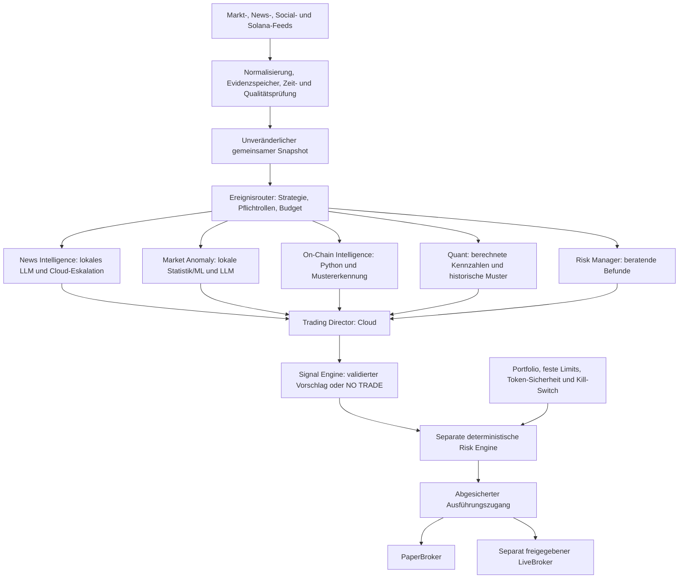

# Zielarchitektur: ereignisgestützte Solana-Trading-Engine

Aktualisiert nach der [Nutzer-Zieldefinition](PROJECT_GOAL.md) vom 21. Oktober 2026.
Die vollständigen sechs strukturierten Zielrollen, lokale Modellrouten,
ereignisgesteuerte Auswahl, Social-/On-Chain-Überwachung und Anomaly-Modelle sind
**noch nicht implementiert**. Quant, Director und Risk existieren bisher als
Textrollen. Der aktuelle Research-Lauf bleibt bis zur getesteten Migration
Director-These -> Quant -> Sentiment -> Risk -> Director-Synthese. Belegter Stand,
Anpassungen und nächste Arbeit stehen im [Zielabgleich](GOAL_ALIGNMENT.md).

Ziel sind begründete Handelsgelegenheiten über **Minuten bis Stunden**.
Sekunden-Sniping und ein Geschwindigkeitswettbewerb mit spezialisierten
Low-Latency-Bots gehören nicht zum Ziel. RSI/MACD sind reproduzierbare Merkmale
und Vergleichsbaselines; sie ersetzen keine ereignisgestützte Strategie.

## Rollen und Rechenorte

| Rolle | Aufgabe und Eingaben | Geplanter Rechenort | Strukturierte Ausgabe |
| --- | --- | --- | --- |
| **News Intelligence Agent** | Nachrichten, Ankündigungen und Social-Media-Beiträge überwachen; Ereignisse erkennen, betroffene Coins anhand Chain/Mint zuordnen, mögliche Auswirkungen und Neuigkeitswert gegenüber bereits bekanntem Wissen bestimmen | Lokales LLM; begrenzte Cloud-Eskalation bei unklaren, widersprüchlichen oder besonders relevanten Meldungen | Ereignistyp, betroffene Mints, Originalquellen, Erstkenntnis/Publikationszeit, neu/bereits bekannt/unklar, Wirkungshypothese, Gegenbelege, Unsicherheit |
| **Market Anomaly Agent** | Ungewöhnliche Preis-/Volumen-Verhältnisse, Regime-/Volatilitätsänderungen, Orderbuch-Ungleichgewichte und Liquiditätsbewegungen erkennen | Lokale klassische Statistik/ML für die Erkennung, lokales LLM für die Interpretation | Messbare Abweichung, Bezugsfenster/Baseline, Feature-/Modellversion, Score, betroffene Mints, Datenqualität, Interpretation und Unsicherheit |
| **On-Chain Intelligence Agent** | Große Wallet-Transfers, tatsächliche Swaps, Liquiditätspools, Konzentration und ungewöhnliche Solana-Token-Aktivität beobachten | Python und lokale Mustererkennung; ein LLM ist hierfür keine Pflicht | Belegte Transfers/Swaps/Pooländerungen, Wallet-/Cluster-Zuordnung samt Unsicherheit, Konzentration, Transaktions-/Slot-Evidenz und Finalitätsstatus |
| **Quant Agent** | Berechnete Kennzahlen und historische Muster beurteilen; statistische Baselines und Unsicherheit einordnen | Deterministische Python-Berechnung; Modellinterpretation je Rolle konfigurierbar | Datengestützte quantitative Befunde mit Fenster, Merkmal-/Berechnungsversion, Quellen und Unsicherheit; keine vom LLM erfundenen Zahlen |
| **Trading Director** | Die je Strategie erforderlichen unabhängigen Erkenntnisse zusammenführen; Gegenhypothesen und Manipulation berücksichtigen | Bevorzugt leistungsfähigeres Cloud-Modell mit festem Zeit-/Kostenbudget, konfigurierbar | Validierter BUY-/SELL-/HOLD-/NO-TRADE-Vorschlag mit Evidenz-IDs, Begründung, Unsicherheit, Zeitpunkt, Horizont, Gültigkeit und Invalidierungsbedingungen; keine Ordermenge und keine Ausführungsfreigabe |
| **Risk Manager / Risk Advisor** | Qualitative Risiken und Gegenbelege bewerten und der regelbasierten Prüfung strukturierte Hinweise liefern | Modell pro Rolle konfigurierbar; außerhalb des zeitkritischen Ausführungspfads | Belegte Risikohinweise und Unsicherheit, mögliche Verschärfungen; keine Freigabe, Positionsgröße oder Lockerung fester Regeln |

News und Market Anomaly können Informationen interpretieren; ein LLM berechnet
keine Marktkennzahlen als vermeintliche Fakten. Anomaly-Erkennung beginnt mit
prüfbaren statistischen Baselines, bevor komplexere trainierte Modelle eingeführt
werden. Konkrete lokale Modelle, Hardware, Serving-Technik und Cloud-Modelle
werden anhand messbarer Qualität, Latenz, Speicherbedarf und Kosten ausgewählt.
Die Wahl ist noch offen und wird nicht durch diesen Entwurf vorgetäuscht.
Quant bleibt eine eigene Rolle. Market Anomaly nutzt dieselben berechneten
Features zur Abweichungserkennung; die beiden Rollen werden nicht verschmolzen.

Die KI-Schnittstelle soll OpenAI, Anthropic, Google Gemini, DeepSeek und lokale
Ollama-Modelle unterstützen und über LiteLLM erweiterbar sein. Provider, Modell
und Einstellungen sind je Rolle über zentrale Konfiguration wählbar. Die
vorhandene transitive LiteLLM-Abhängigkeit und zwei Modellnamen erfüllen das
noch nicht. Diese Foundation-Lücke wird vor weiteren Intelligence-Schritten
geschlossen. Ein lokaler Provider erfordert keinen OpenAI-Key.

## Datenfluss und feste Ausführungsgrenze

Die ausgewählten Fachrollen arbeiten auf derselben eingefrorenen Sicht mit
explizitem as_of/known_at. Ein Ereignisrouter entscheidet anhand einer versionierten
Strategie-Policy, welche Rollen nötig sind; er muss nicht alle Rollen bei jedem
Ereignis starten. Der Director wartet auf alle Pflichtbefunde. Bei unzureichender
Evidenz ist NO TRADE richtig. HOLD bezeichnet bewusstes Halten vorhandenen
Bestands; beide Aktionen lösen keine neue Order aus. Eine vorab erzeugte
Director-These darf die unabhängige Erkennung nicht unbemerkt verankern; die
Migration trennt die bisherige Research-These vom künftigen Evidenzlauf.

Die **Risk Engine ist ein separates deterministisches Modul**, kein LLM-Agent.
Sie prüft Datenalter und Strategieanforderungen, berechnet Positionsgrößen und
erzwingt Kapital-/Verlustlimits, Liquidität, Slippage, Gebührenreserven,
Token-Sicherheit und Kill-Switch. Der vorhandene Risk-Agent kann später als
strukturierter Risk Advisor weiterentwickelt werden. Er und der Director dürfen feste
Limits weder lockern noch umgehen. Ein Signal allein erlaubt keinen Trade.
Kein Fachagent erhält Wallet-Schlüssel, Signierfunktionen oder Rechte zum
Aktivieren von Live-Handel. Live bleibt standardmäßig aus und benötigt später
eine separate begrenzte Wallet und ausdrückliche Betreiberfreigabe.
Die Risk Engine und die Ausführung benötigen nach dem gültigen Signal keine
weiteren LLM-Aufrufe. Positions-/Konzentrationslimits, tägliche Verlustlimits,
Order-Idempotenz und dauerhafter Kill-Switch gelten auch beim Paper-Trading.

## Datenquellen und Persistenz

Die neue Reihenfolge beginnt nach der Foundation mit einem persistenten News
Collector, Binance WebSocket und DEX Screener. RSS-Grundversorgung: CoinDesk und
BlockBeats; weitere Originalquellen sind Projekt-Veröffentlichungen, Fed und SEC,
The Block nur bei geeignetem Feed und Nutzungsbedingungen. Exa wird optional zur
Vertiefung verwendet. News-Pflicht je Strategie bleibt trotz optionalem Exa bestehen.

Coinbase-WebSockets, GeckoTerminal, Jupiter und die vorhandene optionale
CoinGecko-Pro-Historie ergänzen Marktdaten. CEX-Trades/Orderbücher und AMM-Pools
haben getrennte Verträge; Symbol/Mint/Pool/Währung brauchen explizite Zuordnung.
Helius API/Webhooks/Streaming und Solana RPC/WebSockets liefern On-Chain-Ereignisse;
Bitquery ist optional später. Die Quellenliste stellt noch keinen bestätigten
Zugang dar. Stand und fehlende Adapter sind im Zielabgleich einzeln aufgeführt.

Eine persistente Datenbank speichert Quellen, Empfang/First-seen, Ereignisversionen,
Analysen, Budgets und Audit-Ereignisse, später Portfolio, Orders und Fills. Die
unveränderliche Historienablage bleibt erhalten und wird referenziert. Collector-
Recovery, begrenzte Warteschlangen, Feed-Alter, WebSocket-Reconnect und DB-Backups
sind eigene Aufgaben; ein einzelner Research-Snapshot ist kein laufender Feed.

## Evidenz, Neuigkeit und Datenanforderungen

Ein gemeinsamer Evidence-/AgentFinding-Vertrag muss mindestens Ereignis-ID,
Asset-/Venue-Bezug (bei Solana Chain/Mint), Quelle/Originalquelle, Quellereignis-ID,
event_time, received_at,
known_at, Bezugsfenster, Gültigkeit, Evidenz-Verweise, Verfügbarkeitsstatus,
Modell-/Featureversion und nachvollziehbare Unsicherheit festhalten. Fakten,
Interpretation und mögliche Manipulationshinweise bleiben getrennt. Daten mit
unterschiedlichen Währungen oder Volumeneinheiten werden nicht vermischt.
Makro-/Regulierungsereignisse dürfen mehrere Assets betreffen; eine fehlende
eindeutige Mint-Zuordnung wird nicht erfunden.
Untrusted Artikel-/Social-Inhalte dürfen keine Agentenrechte oder Tools ändern.

Neuigkeit bedeutet **neu gegenüber dem bis dahin gespeicherten Wissen**.
Reposts, Syndizierung, leicht umformulierte Meldungen und später editierte
Ankündigungen benötigen Ereignis-Deduplizierung und Versionierung. Exa schätzt
Publikationszeiten; estimated publication und lokaler first_seen dürfen nicht
vertauscht werden. Eine neu abgerufene alte Meldung ist kein neues Ereignis.
Social-Feeds brauchen eigene lesende Provideradapter, Zugriffs-/Nutzungsprüfung
und datierte Herkunft; sie sind durch die bisherige Exa-News-Suche nicht belegt.

Anomaly-Modelle werden nur auf früher verfügbaren Daten trainiert/normalisiert.
Sie benötigen festgelegte Feature-Fenster, Warm-up, Drift-/Ausfallbehandlung und
versionierte Artefakte. OHLCV ist der erste Modus; ein Orderbuch-Modus erfordert
einen tatsächlich angebundenen Book-Feed mit Sequenz-/Lückenprüfung. Ein
AMM-Pool ist kein Orderbuch: Reserven, Swaps und Routen/Preisimpact brauchen
eigene Einheiten und Baselines. Fehlende Feeds werden explizit gemeldet und
nicht durch eine LLM-Erzählung ersetzt.

On-Chain-Events benötigen zuverlässige Solana-Daten, Transaktionssignatur und
Instruktionsbezug, Slot/Blockzeit, Deduplizierung sowie eine dokumentierte
Bestätigungs-/Finalitäts- und Reorg-Strategie. Ein großer Transfer ist noch kein
Kauf. Swaps und tatsächliche Tokenflüsse müssen klassifiziert werden; interne
Umbuchungen, gemeinsame Wallet-Kontrolle und Unsicherheit der Zuordnung sind
zu berücksichtigen. Eine Wallet ist nicht automatisch ein unabhängiger Akteur.

Cloud-Eskalation erhält ein explizites Routing mit Anlass, Datenfreigabe,
Modellversion und Budget. Lokale und Cloud-Adapter verwenden dieselben
Output-Schemas. Timeout, Budgetüberschreitung oder ein nicht verfügbares lokales
Modell erzeugen definierte Abstention/NO TRADE beziehungsweise eine Ablehnung;
kein unbegrenztes automatisches Eskalieren. Pflichtrollen und Mindestmaß
unabhängiger Bestätigung werden je Strategie festgelegt und getestet.
Tokenverbrauch und Kosten werden pro Agent/Lauf erfasst und durch persistente
Tages-/Monatsbudgets begrenzt. Cache-Schlüssel berücksichtigen Eingabe-/Evidenz-,
Modell-, Prompt- und Schemaversion; Wiederverwendung darf keine veralteten Daten
oder spätere Erkenntnisse einschleusen. Keine permanenten kostenpflichtigen
Websuchen und keine unbegrenzten automatischen Modell-/API-Retries.

## Beispiel und Manipulationsprüfung

Beispiel: Ein freigegebener Solana-Token zeigt stark ansteigendes Handelsvolumen,
mehrere größere Wallet-Käufe, eine neue Social-Ankündigung und zunächst wenig
Preisbewegung. Der Market Anomaly Agent misst die Abweichung zur früheren
Baseline. On-Chain Intelligence belegt tatsächliche Käufe und prüft, ob die
Wallets vermutlich zusammengehören. News Intelligence verfolgt die Ankündigung
zur Originalquelle, prüft Neuigkeit und hält Echtheit/Unsicherheit fest.

Der Director bewertet den Zusammenhang als Hypothese und sucht Gegenbelege.
Ein kopierter Artikel, Wash-Trades und mehrere Wallets desselben Akteurs sind
keine drei unabhängigen Bestätigungen. Künstliches Volumen, Sybil-Wallets,
gekaufte Social-Reichweite, Pump-and-Dump-Kampagnen, geringe Liquidität und nicht
verkaufbare Token sind eigene Prüf-/Ablehnungsfälle. Erst die separate Risk
Engine entscheidet, ob ein daraus entstehender Vorschlag überhaupt zulässig
ist. Das Muster begründet weder einen automatischen BUY noch Profitabilität.

## Nachweis der Vorhersagekraft

Vor einer Strategie-Freigabe werden Ereignisdefinition, Mindest-Evidenz,
Zeithorizonte im Bereich Minuten bis Stunden, Kosten-/Slippage-Annahmen und
Erfolgskriterien festgelegt. Die Evaluation benötigt:

- Zeitlich getrennte Trainings-/Validierungs-/Testfenster und Walk-forward;
  überlappende Zielhorizonte beim Split berücksichtigen. Keine zukünftigen
  News-Edits, Wallet-Cluster oder nachträglich korrigierten Feeds einmischen.
- Out-of-sample Vorhersagegüte und Kalibrierung, False Positives, Abdeckung und
  Abstention; danach wirtschaftliche Wirkung nach Kosten, Drawdown, Profit
  Factor, Trefferquote, Erwartungswert je Trade, Qualität je Horizont und Vergleich
  gegen Buy-and-Hold sowie einfache RSI-/Preisbaselines. Ereignis→Signal→Order-
  Latenz separat messen.
- Ablationen ohne News, ohne On-Chain und ohne Anomaly-Modell: messen, ob jede
  Quelle zusätzlichen Nutzen bietet statt dieselbe Marktbewegung mehrfach zu
  zählen. Manipulierte und illiquide Situationen separat auswerten.
- Unberührte abschließende Testdaten, dokumentierte Experimente/Mehrfachtests,
  Daten-/Modell-/Promptversionen und anschließendes Paper-Trading. Historische
  LLM-Ergebnisse zusätzlich auf Trainingswissen aus späteren Zeiträumen prüfen.

## Betrieb, Umsetzungs-Backlog und Wiederverwendung

Zielbetrieb ist Linux-VPS oder Proxmox mit Docker-Unterstützung, zentraler
Konfiguration, persistenter Datenbank, Healthchecks und Recovery. Ein zunächst
lesendes Dashboard zeigt Marktaktivitäten, Signale, Positionen und Kosten;
Alerts melden wichtige Ereignisse und Ausfälle. Dauerhafte Entscheidungs-/Fehler-
Audits ergänzen die vorhandenen run_id-/Snapshot-/UTC-Daten. Diese Betriebsfunktionen
sind noch nicht vorhanden.

Der gemeinsame Snapshot mit contentgebundenen EvidenceReference-IDs ist in
[Schritt 2.5](RESEARCH_SNAPSHOTS.md) umgesetzt. Semantische EvidenceEvent-/
AgentFinding-Verträge und die folgenden Rollen-/Feed-Aufgaben sind weiterhin
offen. Die aktuelle Reihenfolge mit Abhängigkeiten und Abnahmen steht im
[G1–G7-Backlog](GOAL_ALIGNMENT.md). Die unpräfixierten bisherigen Plan-IDs sind
Legacy-Referenzen und werden dort auf die sieben neuen Phasen abgebildet.

| Zielphase | Nächste Aufgaben | Wiederverwendung |
| --- | --- | --- |
| G1 Foundation | Providervertrag, sechs Rollenkonfigurationen, Swarms-Brücke, lokale/Cloud-Adapter | Settings, gemeinsame Fehler, Lifecycle-Tests |
| G2 Data Collection | Ereignisspeicher, RSS, Binance und DEX Screener, weitere Quellen einzeln | Datenverträge, HTTP-Transport, HistoryStore und Snapshot |
| G3 Market Intelligence | Budgets/Cache, News-Klassifikation, statistische Anomalien, später lokale ML | Indikatoren, Sentiment-/Exa-Kern, Qualitätsregeln |
| G4 On-Chain Intelligence | RPC/Helius, Ereignisklassifikation und Python-Muster | Solana-Identität, Zeit-/Evidenzverträge |
| G5 Trading Intelligence | Ereignisrouter, strukturierte Quant-/Risk-Befunde, Director und Signal Engine | Frische Agenten-Factory, Research-Orchestrator, Signal-Basisschema |
| G6 Risk & Paper | Deterministische Limits, Ledger, Kill-Switch, PaperBroker und kausale Evaluation | Bestehende Historien und Portfolio-Basisschemas; keine Übernahme des experimentellen Fill-Modells |
| G7 Production | Recovery, Docker, Monitoring/Dashboard/Alerts, zuletzt separat freigegebener Live-Modus | Logging und Snapshot-/Run-IDs |

Bestehende funktionierende Komponenten bleiben Grundlage: Settings und
Secret-Redaction, Providertransport, Exa, Jupiter, optionale CoinGecko-Historie,
immutable Replay, deterministische Indikatoren, Datenqualitätsprüfung und frische
Agenten-Factory. Der Umbau erfolgt mit Rückwärtskompatibilität und eigenen
Regressionstests pro Schritt, ohne einen vollständigen Rewrite.
